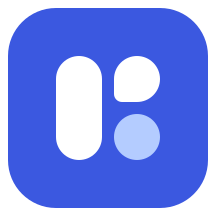
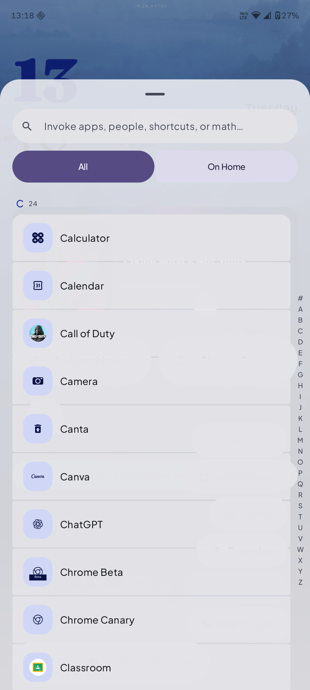
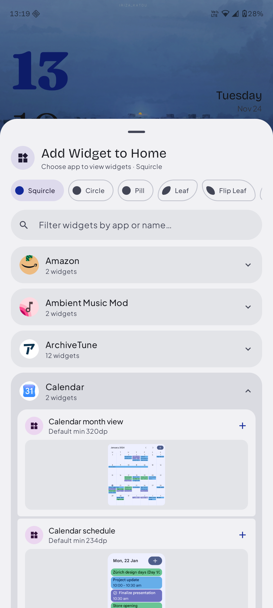
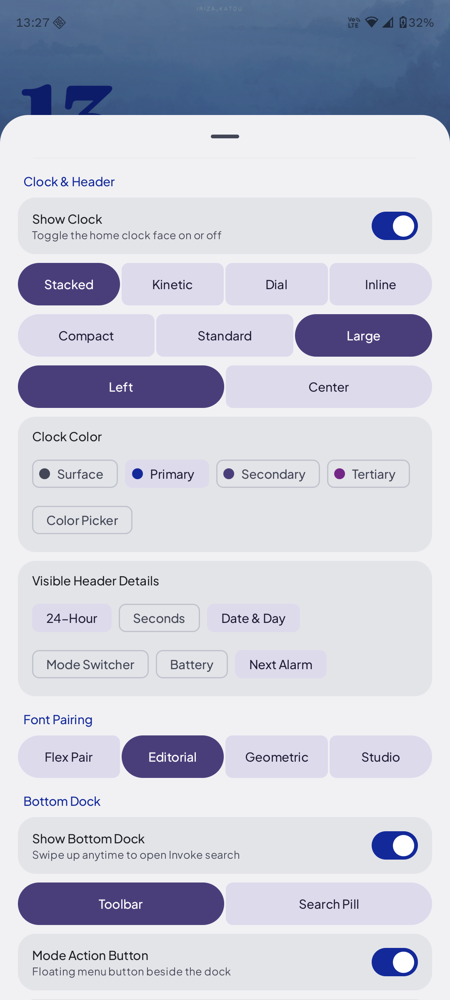
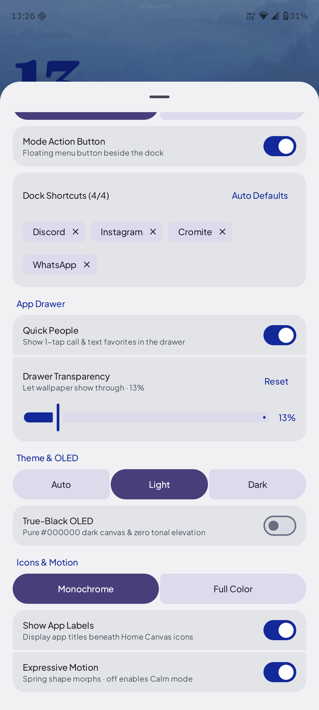
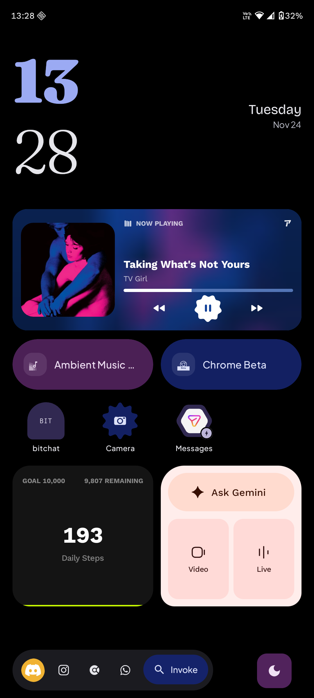

<div align="center">
  
  <h1>Invoke</h1>
  <p><strong>A fast, fluid, Material 3 Expressive Android home launcher built with Jetpack Compose.</strong></p>
  <p>
    Bento Canvas &middot; Morphing Shapes &middot; Universal Search &middot; Customization Studio
  </p>
  <p>
    <a href="#quick-start-guide">Quick Start</a> &middot;
    <a href="#screenshots">Screenshots</a> &middot;
    <a href="#features">Features</a> &middot;
    <a href="#gestures--shortcuts">Gestures</a> &middot;
    <a href="#privacy--permissions">Privacy</a> &middot;
    <a href="#sponsor--support">Sponsor</a> &middot;
    <a href="#installing">Install</a>
  </p>
</div>

---

## Why Invoke?

Traditional Android launchers force apps into repetitive icon grids with rigid widget containers. Invoke re-imagines your home screen as a living, personalized Bento canvas:

- **Bento Harmony** &mdash; Mix apps, widgets, quick people, and shortcuts into expressive, fluid blocks.
- **13 Morphing Shapes** &mdash; Squircles, leaves, arches, pills, clovers, and gems with smooth physics-based touch morphing.
- **Instant Search** &mdash; Type initials (yt for YouTube), math expressions (45 * 12), or contact actions (call Alex) with immediate keyboard execution.
- **Respects Your Privacy** &mdash; Zero runtime permissions requested. No contact scraping, no background network pings, no telemetry. Contacts are picked strictly through Android's system contact picker.
- **True-Black OLED Ready** &mdash; Switch instantly between daytime styling, a calm Deep Focus setup, or battery-saving Night OLED mode with pure #000000 dark surfaces.
- **Independent &amp; Free of Ads** &mdash; Built without tracking or ads. Support development at [invokevirtual.org/sponsor](http://invokevirtual.org/sponsor/).

---

## Screenshots

<table>
  <tr>
    <td align="center" width="25%">
      <br />
      <sub><strong>Everyday Home</strong><br />Bento tiles, live widgets &amp; Timepiece Monument</sub>
    </td>
    <td align="center" width="25%">
      <br />
      <sub><strong>App Drawer &amp; Search</strong><br />Fuzzy search, filter pills &amp; A&ndash;Z rail</sub>
    </td>
    <td align="center" width="25%">
      <br />
      <sub><strong>Home Editor</strong><br />13 morphing shapes, size &amp; tone inspector</sub>
    </td>
    <td align="center" width="25%">
      <br />
      <sub><strong>Add Widget</strong><br />App-grouped widgets &amp; shape presets</sub>
    </td>
  </tr>
  <tr>
    <td align="center" width="25%">
      <br />
      <sub><strong>Studio &middot; Color &amp; Palettes</strong><br />Material You, palettes &amp; 2D HSV picker</sub>
    </td>
    <td align="center" width="25%">
      <br />
      <sub><strong>Studio &middot; Clock &amp; Fonts</strong><br />4 clock faces, glance items &amp; pairings</sub>
    </td>
    <td align="center" width="25%">
      <br />
      <sub><strong>Studio &middot; Drawer &amp; OLED</strong><br />Dock, transparency, OLED &amp; motion</sub>
    </td>
    <td align="center" width="25%">
      <br />
      <sub><strong>Night OLED</strong><br />Pure #000000 canvas &amp; zero elevation</sub>
    </td>
  </tr>
</table>

---

## Quick Start Guide

1. **Set as Default Launcher**: Go to **Settings &rarr; Apps &rarr; Default apps &rarr; Home app** and select **Invoke**.
2. **Open Apps &amp; Search**: Swipe up from anywhere on your home screen or tap the **Invoke** dock pill.
3. **Customize Your Home**: Tap the floating action button at the bottom right to open the Mode Menu:
   - **Edit Home** &mdash; Tap any tile to change shape, size (1x1, 2x1, 2x2), colors, or position.
   - **Add Widget** &mdash; Browse widgets grouped by app with live previews.
   - **Studio** &mdash; Personalize wallpapers, palettes, clock faces, drawer transparency, and font pairings.
4. **Switch Modes**: Tap the action button anytime to toggle between **Everyday**, **Deep Focus** (top 4 essentials only), and **Night OLED** (pure black surfaces).

---

## Gestures &amp; Shortcuts

| Gesture / Action | Result |
| :--- | :--- |
| **Swipe Up** anywhere | Opens **Invoke Search &amp; App Drawer** |
| **Swipe Down** from top | Pulls down your system notification shade &amp; quick settings |
| **Tap Bottom-Right Button** | Opens the **Workspace Mode Menu** (Edit, Widget Board, Studio, Modes) |
| **Long-Press any Tile** | Opens quick app shortcuts, app info, notification badges, or remove/edit actions |
| **Long-Press Contact in Drawer** | Pin to Home Canvas, call, message, or remove from Quick People |
| **Scrub Right Edge (A&ndash;Z)** | Instant haptic alphabet jumping across installed applications |
| **Back Gesture** | Smooth predictive gesture closing sheets, menus, and search |

---

## Features

### Living Bento Canvas
- **Expressive Shapes**: 13 geometry options (Squircle, Circle, Pill, Leaf, Leaf Alt, Arch, Teardrop, Gem, Hexagon, Cookie, Clover, Burst, Rectangle) with spring-physics touch morphs.
- **Flexible Grid Sizing**: Choose from Compact (1x1), Wide (2x1), or Feature (2x2) layouts.
- **Custom Tile Styling**: Pick from dynamic tones (Primary, Secondary, Tertiary, Surface) or assign any custom color with the built-in color picker.
- **Dock Options**: Choose between an app-shortcut Toolbar (up to 4 quick apps + Invoke pill) or a minimal Search Pill.

### Universal Search &amp; Drawer
- **Instant Abbreviation Matching**: Launch apps quickly by initials (yt for YouTube, ps for Play Store, cal for Calculator).
- **Inline Calculator**: Type math expressions directly into the search bar (128 * 4 or (12 + 8) / 4) to get instant results with one-tap copying.
- **Quick People**: One-tap call and message favorites. Type natural verbs (call mom, text alex) to open dialer or messaging immediately.
- **Profile &amp; Vault Filtering**: Filter tabs for All, On Home, and Work profile apps. Lock or unlock Private Space directly from the drawer.
- **Adjustable Transparency**: Blend the app drawer over your wallpaper from 0% (solid) to 100% (translucent).

### Timepiece Monument &amp; Modes
- **4 Clock Layouts**: Stacked, Kinetic, Dial, and Inline faces with customizable size and alignment.
- **Glance Bar**: Battery status, charging indicators, and next alarm display.
- **3 Modes**:
  - **Everyday** &mdash; Full Bento canvas, widgets, and dock.
  - **Deep Focus** &mdash; Minimalist view showing only your top 4 daily tools.
  - **Night OLED** &mdash; Pure-black (#000000) canvas for battery efficiency and night comfort.

### Customization Studio
- **Material You Dynamic Color**: Automatic color scheme extraction from your active wallpaper.
- **Curated Palettes**: Built-in themes: Tangerine, Sage, Cobalt, and Plum.
- **Custom Accent Engine**: Saturation/Value color picker with automatic contrast optimization.
- **Font Pairings**: Select from Google Fonts pairings: Flex Pair (Google Sans Flex), Editorial (Fraunces), Geometric (Space Grotesk), and Studio (Roboto Flex).
- **Icon Styling &amp; Motion**: Choose themed monochrome or full-color icons, toggle app labels, and switch between Expressive motion and Calm mode.

---

## Privacy &amp; Permissions

| Permission | Usage in Invoke |
| :--- | :--- |
| **Internet** | **None** &mdash; Invoke contains zero network permissions. No analytics, no ads, no remote servers. |
| **Contacts** | **None** &mdash; Contacts are chosen exclusively through Android's system contact picker. Invoke never reads your address book. |
| **Storage / Photos** | **None** &mdash; Wallpaper and colors are accessed through standard Android wallpaper APIs. |
| **App List** | Used strictly on-device to display and launch installed applications. |

---

## Sponsor &amp; Support

Invoke is independent, open source, and completely free of ads and tracking. If you enjoy using Invoke, please consider supporting continued development:

- **Sponsor Invoke**: [http://invokevirtual.org/sponsor/](http://invokevirtual.org/sponsor/)

You can also find this link directly in the app header under **Customization Studio &rarr; Sponsor**.

---

## Installing

### Download
Download the latest APK release from GitHub Releases and install it on any device running Android 8.0 (API 26) or higher.

### Building from Source
If building from source:

```bash
git clone https://github.com/invokevirtual/invoke.git
cd invoke
./gradlew :app:assembleDebug
```

The APK will be generated at `app/build/outputs/apk/debug/app-debug.apk`.

---

## License

```text
Licensed under the Apache License, Version 2.0 (the "License");
you may not use this file except in compliance with the License.
You may obtain a copy of the License at

    http://www.apache.org/licenses/LICENSE-2.0
```
