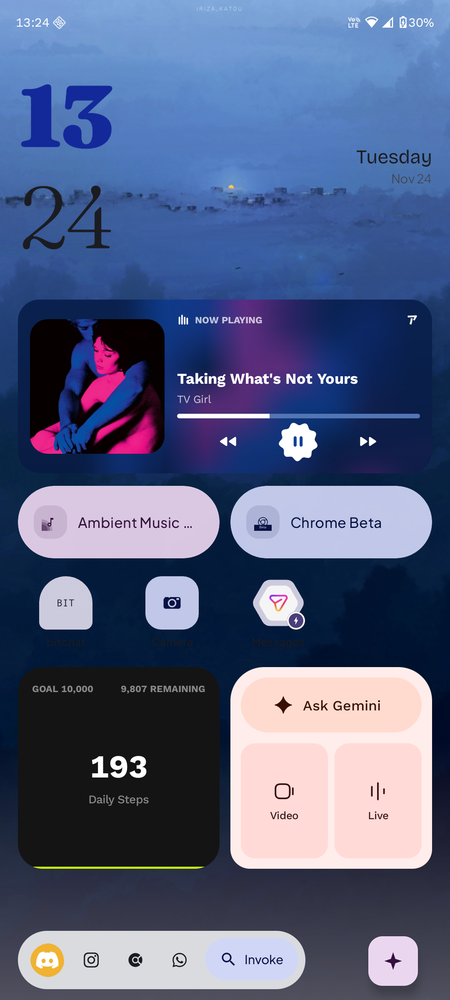
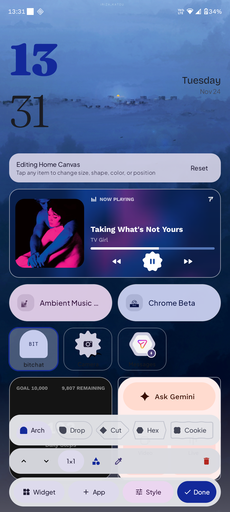
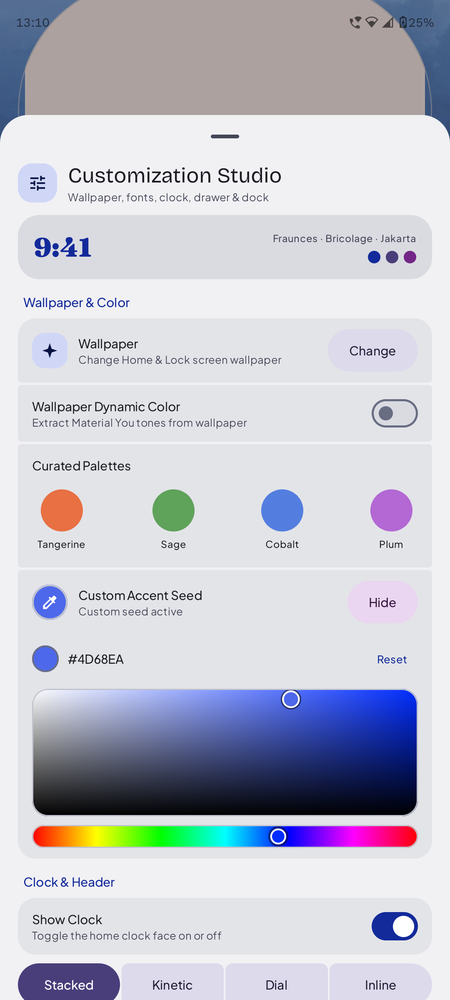

<div align="center">
  
  <h1>Invoke</h1>
  <p><strong>A fast, fluid Material 3 Android launcher built with Jetpack Compose.</strong></p>
  <p>
    <a href="#screenshots">Screenshots</a> &middot;
    <a href="#quick-start">Quick Start</a> &middot;
    <a href="#features">Features</a> &middot;
    <a href="#gestures">Gestures</a> &middot;
    <a href="#sponsor">Sponsor</a>
  </p>
</div>

---

## Screenshots

<table>
  <tr>
    <td align="center" width="25%">
      <br />
      <sub><strong>Everyday Home</strong><br />Bento tiles, widgets &amp; clock</sub>
    </td>
    <td align="center" width="25%">
      <br />
      <sub><strong>App Drawer &amp; Search</strong><br />Fuzzy search &amp; A&ndash;Z rail</sub>
    </td>
    <td align="center" width="25%">
      <br />
      <sub><strong>Home Editor</strong><br />13 morphing shapes &amp; inspector</sub>
    </td>
    <td align="center" width="25%">
      <br />
      <sub><strong>Add Widget</strong><br />App-grouped widgets</sub>
    </td>
  </tr>
  <tr>
    <td align="center" width="25%">
      <br />
      <sub><strong>Color &amp; Palettes</strong><br />Material You &amp; HSV picker</sub>
    </td>
    <td align="center" width="25%">
      <br />
      <sub><strong>Clock &amp; Fonts</strong><br />Faces, details &amp; font pairings</sub>
    </td>
    <td align="center" width="25%">
      <br />
      <sub><strong>Drawer &amp; OLED</strong><br />Dock, blur &amp; motion tuning</sub>
    </td>
    <td align="center" width="25%">
      <br />
      <sub><strong>Night OLED</strong><br />Pure black canvas</sub>
    </td>
  </tr>
</table>

---

## Quick Start

1. **Set Default**: Open **Settings &rarr; Apps &rarr; Default apps &rarr; Home app** and pick **Invoke**.
2. **Search**: Swipe up anywhere on the home screen or tap the **Invoke** dock pill.
3. **Customize**: Tap the bottom-right button to edit tiles, add widgets, or open **Studio**.
4. **Switch Modes**: Toggle between **Everyday**, **Deep Focus** (top 4 essentials), and **Night OLED** (pure black).

---

## Features

- **Bento Canvas** &mdash; Mix apps, widgets, quick people, and shortcuts into flexible 1x1, 2x1, or 2x2 blocks.
- **13 Morphing Shapes** &mdash; Squircles, leaves, arches, pills, clovers, and gems with smooth touch morphing.
- **Universal Search** &mdash; Search apps by name or initials (yt for YouTube), run math in the search bar, or dial contacts with natural verbs (call Mom).
- **Workspace Modes** &mdash; Everyday, Deep Focus, and true-black Night OLED (#000000).
- **Customization Studio** &mdash; Dynamic wallpaper colors, 4 curated palettes, 2D color picker, clock styles, font pairings, and drawer transparency.

---

## Gestures

| Gesture | Action |
| :--- | :--- |
| **Swipe Up** | Opens App Drawer &amp; Search |
| **Swipe Down** | Opens Status Bar / Notifications |
| **Tap Bottom-Right Button** | Opens Mode Menu (Edit, Widgets, Studio, Modes) |
| **Long-Press Tile** | Shortcuts, resize, shape, and tile settings |
| **Scrub Right Edge** | Alphabet index jump in drawer |

---

## Sponsor

Invoke is independent, open source, and ad-free.

<p>
  <a href="http://invokevirtual.org/sponsor/">
    
  </a>
</p>

---


## License

Reef is licensed under the [MIT License](https://opensource.org/licenses/MIT). You are free to use,
modify, and distribute this
software.

### 1. Mandatory Attribution

Any derivative work, fork, or redistribution of this software **must** include a prominent link back
to the original repository.
This link must be visible to the end-user (e.g., in the "About" or "Settings" screen of the app).

### 2. Trademark & Branding

The name **"Invoke"** and the **official app icon** are trademarks of Pranav Purwar.

* You are **not** permitted to use the name "Invoke" or the original icon for any derivative works or
  forks.
* Any redistribution must use a distinct name, a different package ID (e.g., changing
  `org.invokevirtual.launcher` to something else), and a unique launcher icon.
* This is to prevent confusion among users and to maintain the integrity of the original project.

```text
MIT License

Copyright (c) 2023-2026 Pranav Purwar

Permission is hereby granted, free of charge, to any person obtaining a copy
of this software and associated documentation files (the "Software"), to deal
in the Software without restriction, including without limitation the rights
to use, copy, modify, merge, publish, distribute, sublicense, and/or sell
copies of the Software, and to permit persons to whom the Software is
furnished to do so, subject to the following conditions:

The above copyright notice and this permission notice shall be included in all
copies or substantial portions of the Software.

THE SOFTWARE IS PROVIDED "AS IS", WITHOUT WARRANTY OF ANY KIND, EXPRESS OR
IMPLIED, INCLUDING BUT NOT LIMITED TO THE WARRANTIES OF MERCHANTABILITY,
FITNESS FOR A PARTICULAR PURPOSE AND NONINFRINGEMENT. IN NO EVENT SHALL THE
AUTHORS OR COPYRIGHT HOLDERS BE LIABLE FOR ANY CLAIM, DAMAGES OR OTHER
LIABILITY, WHETHER IN AN ACTION OF CONTRACT, TORT OR OTHERWISE, ARISING FROM,
OUT OF OR IN CONNECTION WITH THE SOFTWARE OR THE USE OR OTHER DEALINGS IN THE
SOFTWARE.
```

---
